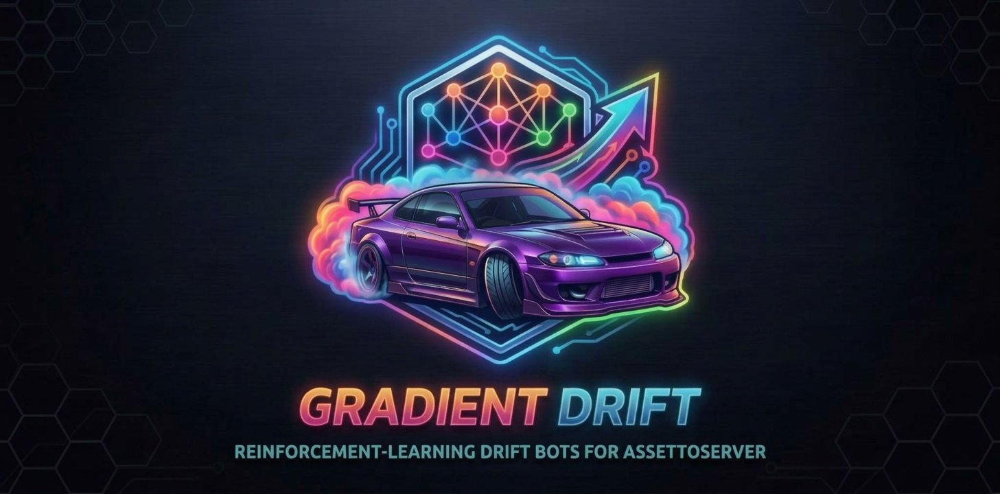

<p align="center"></p>

<h1 align="center">gradient-drift</h1>

<p align="center">
  <b>Reinforcement-learning drift bots for <a href="https://github.com/compujuckel/AssettoServer">AssettoServer</a> (Assetto Corsa)</b>
</p>

<p align="center">
  <a href="https://github.com/toyowheelin/gradient-drift/releases/latest"></a>
  <a href="https://github.com/toyowheelin/gradient-drift/releases"></a>
  <a href="https://github.com/toyowheelin/gradient-drift/actions/workflows/build-plugin.yml"></a>
  <a href="LICENSE"></a>
</p>

<p align="center">
  <a href="https://github.com/compujuckel/AssettoServer"></a>
  
  
  
</p>

<p align="center">
  <a href="#quick-start">Quick start</a> ·
  <a href="#how-the-bot-drives">How the bot drives</a> ·
  <a href="GradientDriftPlugin/SETTINGS.md">Settings</a> ·
  <a href="setup/README.md">Setup program</a> ·
  <a href="drift_rl/README.md">Training</a> ·
  <a href="CREDITS.md">Credits</a>
</p>

A server plugin takes over the server's AI cars and drives them sideways: linked drifts, tandem
trains, door to door, on the server's own track. The driving comes from a small neural network
trained offline, by reinforcement learning, in a simulator of the plugin's own vehicle model. It
ships as one `policy.json`; nothing learns on the live server.

> [!NOTE]
> **Vibe coded.** Practically all of this project was written by Claude, Anthropic's AI assistant,
> working with the owner in conversation: the plugin, the simulator and trainer, the setup program,
> the tests and these docs. The owner set the direction, ran the training and the server tests,
> and judged the driving. Every change is checked against the simulator, and the plugin has driven
> on real servers, but the code has not had a line-by-line human review. Read it, and run it on
> your own server, with that in mind.

## What it does

| | |
|---|---|
| 🏁 **Any track** | The shipped policy was trained on seven real tracks and 100 randomly generated courses, so it drives tracks it has never seen. The setup program makes a track's data from your own game install. |
| 🚗 **Any rear-drive car** | Every bot drives as a drift car (welded diff, an angle kit of at least 50°), with its weight, geometry, tyres, power and gearing from the car's own files. |
| 🚦 **Several bots** | Spread round the lap, or in tandem trains where followers hold the lead car's line a car length behind. |
| 🎛️ **Two dials** | How fast (a share of the track's flat-out drift speed), and how good a driver: from a careful novice who still holds a drift to the best the policy can do. |
| 🧑 **Close to a human** | On the owner's server the bots rotate the car about as hard and as often as a human drifting the same track (yaw acceleration, direction changes, sideways g, time sliding). |

**Limits:** tested on Windows servers only (the same plugin download should run on Linux too, as
a .NET plugin with no native code, but nobody has tried it yet); rear-drive cars only;
and the bots don't see each other or the players, so a car that spins can be driven through by
the one behind.

## Quick start

**You need** AssettoServer v0.0.54, and the game installed on the machine you run setup on (setup
reads the track and the cars from it).

1. **Download the release**: one zip, `gradient-drift-<version>.zip`, from the
   [latest release](https://github.com/toyowheelin/gradient-drift/releases/latest). Unzip it
   anywhere. It has the setup program for Windows (`windows/`) and for Linux (`linux/`), each with
   the plugin already in its `GradientDriftPlugin` folder, where setup finds it. Each release is
   built for one AssettoServer version, named in its title and README; on another version the
   plugin says so in the server log at start. To build the
   plugin yourself instead, see [Building the plugin](#building-the-plugin).
2. **Run the setup program** ([`setup/`](setup/README.md)). Point it at the game install and the
   server folder, then choose the bot car, how many bots, trains and pace. It shows every change
   before and after, makes them on a yes, keeps the originals, and can undo. It copies in the
   plugin, writes each bot car's numbers, adds the bot entries, sets the AI settings AssettoServer
   needs, and makes the track's data if it's missing.
3. **Start the server** and drive. The plugin's log lines start `GradientDrift:`: one when the
   policy loads, then nothing while the bots drive well. It warns only when something is wrong:
   why, if it stands aside and leaves the stock AI driving, or which bot is stuck and where.
4. **Tune it** in the server's `extra_cfg.yml`, then restart the server.
   [`SETTINGS.md`](GradientDriftPlugin/SETTINGS.md) lists every setting; the ones you'll want are
   `BotSkill`, `BotPacePercent` and `TrainSize`.

> [!TIP]
> **Server on a hosting plan?** Run setup on your own PC against the server's downloaded `cfg`
> folder and upload what it exports: see
> [A server on a hosting plan](setup/README.md#a-server-on-a-hosting-plan-or-any-machine-without-the-game).
>
> **Trying a policy of your own?** Copy it over
> `plugins/GradientDriftPlugin/GradientDriftPlugin.policy.json` (keep the old one) and restart. No
> rebuild is needed.

## How the bot drives


Every server tick (18 a second on a typical server), for every bot it drives, the plugin does the
same four things:

1. **Describe the car's situation as 67 numbers.**
   - how the car is moving: speed, sideways speed, how fast it is rotating, its slip angle;
   - the racing line: where it is and how it bends over the next stretch;
   - its sensors: what 15 rays fanned out ahead and 6 short rays fixed to the body hit (the walls
     the game collides with, and the course's tire stacks), and how much room there is to the
     course's edges;
   - what it did last tick, the pace it has been asked to drive and how far over that it has been
     lately;
   - what car it is (weight, wheelbase, grip, power), and how good a driver it has been asked to be.
2. **Run them through the network.** Each number is scaled the way it was in training, then
   multiplied through two layers of 128 units (about 26,000 numbers in all, the whole content of
   `policy.json`). That takes about 0.1 ms a car.
3. **Read three numbers out:**

   | output | what it does |
   |---|---|
   | steering | how far to turn the wheel |
   | pedal | throttle above zero, all four brakes below zero (off in the shipped policy, which brakes with the front brake only: `FrontBrakeOnly`) |
   | front brake | 0 to 1, a separate front-axle brake applied on top of whatever the pedal is doing |

   The network decides both pedals each tick, so it can use them together: throttle to keep the
   rear spinning and the angle held, front brake to scrub off speed (left-foot braking, the way a
   drifter keeps a gap without straightening up). On a server run the front brake was in use about
   a fifth of the time, almost always with the throttle on.
4. **Move the car itself.** The plugin's own vehicle model turns those into tire forces (each
   axle's grip from the car's tyre file, less as the tyres carry more load), a slide, wall contact
   and ride height. The server sends players the car's new position, speed and rotation, with
   wheels, steering, engine and gear to match. On the next tick the rays, the line and the speeds
   all read differently, and the loop goes round again.

**Where the driving comes from.** The network never sees a "drift" instruction. It learned what to
do in `drift_rl`'s simulator, which runs the same vehicle model and the same sensors as the
plugin, by driving hundreds of millions of ticks on real and randomly generated courses, in 28
different cars, and being rewarded for progress made sideways at a good angle, inside the course,
without hitting anything (reinforcement learning, PPO). The result is frozen into `policy.json`;
the server only runs it.

The plugin also runs older, smaller policies (46 to 55 inputs, one car). The parts of the vehicle
model a policy was trained with are listed in its file and the plugin turns on exactly those, so
each policy drives in the car it learned in.

## What is here

| folder | what it is |
|---|---|
| [`GradientDriftPlugin/`](GradientDriftPlugin/) | The server plugin (C#). `GradientDriftPlugin.policy.json` is the trained policy it runs; [`SETTINGS.md`](GradientDriftPlugin/SETTINGS.md) lists its settings; [`HISTORY.md`](GradientDriftPlugin/HISTORY.md) is how each part of it came about, and the server tests. |
| [`setup/`](setup/README.md) | The setup program for server operators: reads a server, says what it needs for drift bots, and makes those changes on a yes, with backups and an undo. |
| [`drift_rl/`](drift_rl/README.md) | The simulator, trainer and evaluation tools (Python), for training a policy of your own. |
| `tools/` | `track_triangles.py` writes a track layout's geometry as two triangle files (what its model shows, and what the game collides with), using `kn5_reader.py` from KN5 Blender Tools. `ai_car_monitor.py` is an in-game app that logs what a client sees of every car on the server. |

## What the plugin does on a server

- **Nothing reachable from outside.** It opens no ports and adds no web pages, chat commands or
  client messages; players cannot send it anything. It reads the other cars' positions only to
  keep bots away from them.
- **Reads numbers, writes nothing.** At start it reads its policy
  (`plugins/GradientDriftPlugin/GradientDriftPlugin.policy.json`), the bot cars' files
  (`plugins/GradientDriftPlugin/cars/`) and the track's data files from the server folder: numbers
  only, nothing in them is run. What it has to say goes to the server's own log and console.
- **Telemetry, only if you turn it on** (`EnableTelemetryLogging: true`, for checking a policy with
  `drift_rl`): `drift_physics_telemetry_<date>_<time>.csv` in the server folder, every AI car every
  tick and, with `LogHumanCarForCalibration: true`, the first connected player's car (position,
  speed, inputs; no name, IP or Steam ID). About 110 MB an hour with six bots; it stops at
  `TelemetryMaxFileMegabytes` (500) or the first failed write.
- **It cannot take the server down.** AssettoServer shuts down after 10 tick updates in a row
  fail; an error inside the plugin is logged instead, and after 5 in a row it stops and the stock
  AI drives.

## No game content included

No car or track data ships with this project, now or in a release. Each user generates what the
tools need from the game content installed on their own machine.

- **Track files** (`drift_rl/tracks/<track>/`): the track's AI line and mesh, the course edges,
  markers and zones generated from them, and pictures of them. The trainer needs them;
  [`drift_rl/README.md`](drift_rl/README.md#1-track-data) says how to make them from your own copy
  of the track.
- **Car files**, and the numbers extracted from them: `drift_rl/cars/` has the extraction tools only.
- **Telemetry and recordings.**

## Building the plugin

The [releases](https://github.com/toyowheelin/gradient-drift/releases) carry the plugin built. To build it yourself: it
compiles against AssettoServer's own source, so you need that too.

**You need:** the [.NET 8 SDK](https://dotnet.microsoft.com/download/dotnet/8.0) and
[git](https://git-scm.com/).

**1. Get AssettoServer's source at v0.0.54**, the version the plugin is built and tested against.
Clone it whole, not with `--depth 1`, because its build reads its version from git:

```
git clone --branch v0.0.54 https://github.com/compujuckel/AssettoServer.git
```

**2. Put the plugin inside it.** Copy this repository's `GradientDriftPlugin/` folder into the
AssettoServer folder, next to its own projects. The plugin's `.csproj` finds them by relative path,
so it has to sit exactly here:

```
AssettoServer/
├── AssettoServer/              (AssettoServer's own projects)
├── AssettoServer.Shared/
└── GradientDriftPlugin/        <- this repository's folder
    ├── GradientDriftPlugin.csproj
    ├── GradientDriftPlugin.policy.json
    └── *.cs
```

The plugin is one folder of this repository, so git can't clone it into that spot on its own. To
build from a clone you can update with `git pull`, clone this repository somewhere else and link its
folder into the AssettoServer tree instead of copying it. On Windows (PowerShell, from the folder
holding both clones):

```
git clone https://github.com/toyowheelin/gradient-drift.git
New-Item -ItemType Junction -Path AssettoServer\GradientDriftPlugin -Target (Resolve-Path gradient-drift\GradientDriftPlugin)
```

On Linux: `ln -s ../gradient-drift/GradientDriftPlugin AssettoServer/GradientDriftPlugin`.

**3. Build it:**

```
cd AssettoServer/GradientDriftPlugin
dotnet build
```

The first build also builds the AssettoServer projects it references, so it takes a minute. The
result is in `bin/Debug/net8.0/`. The three files the server needs are:

| file | what it is |
|---|---|
| `GradientDriftPlugin.dll` | the plugin |
| `GradientDriftPlugin.deps.json` | what it depends on, for .NET to load it |
| `GradientDriftPlugin.policy.json` | the trained policy, copied in from the source folder |

**4. Install it on the server.** The [setup program](setup/README.md) does this for you: point its
`--plugin` option (or the window's **Plugin build** field) at the `bin/Debug/net8.0/` folder. To do it by
hand, stop the server first (Windows keeps the files locked while it runs), then copy the three
files into the server's `plugins/GradientDriftPlugin/` folder, making the folder if it's new. On
Windows, from the AssettoServer folder:

```
copy GradientDriftPlugin\bin\Debug\net8.0\GradientDriftPlugin.* "D:\servers\my server\plugins\GradientDriftPlugin\"
```

A server set up by hand also needs the plugin turned on in `cfg/extra_cfg.yml` (setup writes this
too; see [`SETTINGS.md`](GradientDriftPlugin/SETTINGS.md)):

```yaml
EnablePlugins: [GradientDriftPlugin]
--- !GradientDriftConfiguration
EnableLearnedPolicy: true
```

**5. Check it loaded.** Start the server and look for `GradientDrift: policy loaded from ...` in its
log. If the plugin stands aside, a warning there says why, and the stock AI drives. After that the
plugin stays quiet while the bots drive: it writes to the log only when something is wrong, such as a
bot stuck for 30 seconds. `VerboseLogging: true` in the plugin's settings brings back the full
output: what it loaded, each bot car, spawns and timing.

> [!TIP]
> **Updating.** After pulling a newer version of this repository, copy its `GradientDriftPlugin/`
> folder over the one inside AssettoServer again, rebuild, and copy the three files in again. A new
> policy on its own needs no rebuild: copying the `.policy.json` is enough. Keep the build folder's
> copy of the policy in step with the server's, or the next copy from the build puts the old policy
> back.

`.github/workflows/build-plugin.yml` runs these same steps on every change to the plugin, so a
build that breaks shows up there first.

## Training your own policy

Optional: the plugin ships with a policy. The full guide is [`drift_rl/README.md`](drift_rl/README.md);
in short, from `drift_rl/`:

```
# the track's data, once
python setup_track.py <game>/content/tracks/<track>

# train, starting from the shipped policy
python train_ppo_gpu.py --sim cpu --init-policy ../GradientDriftPlugin/GradientDriftPlugin.policy.json --track <track> --car-pool cars/car_pool.json --skill 0 1 --reward weave_penalty=5 --reward swing_penalty=4 --steps 30000000 --name <run>

# how it drives (list more policies to compare)
python drive_report.py runs/<run>/policy.json --track <track>
```

To make the bots drive one track better, train the shipped policy further on that track and put the
result on that track's server only: the steps and what to check are in
[Polishing the shipped policy for one track](drift_rl/README.md#polishing-the-shipped-policy-for-one-track).

<details>
<summary><h2>The name</h2></summary>

**gradient-drift** is a pun on gradient descent, the method that trains the network: training
works out which way each of the network's ~26,000 numbers should move to do better and nudges
them that way, millions of times (PPO, the algorithm used, is a *policy-gradient* method). Claude
suggested it: asked for a name with a bit of flavour that kept the machine-learning angle, it gave
a short list and picked this one as its favourite, and the owner chose it on 2026-10-07. It reads
as a drift name to car people and as a machine-learning name to machine-learning people, which is
who this project is for.

The server plugin follows AssettoServer's own naming, so it reads like the plugins that ship with
it (`RandomWeatherPlugin` is configured by a `--- !RandomWeatherConfiguration` block):

```yaml
EnablePlugins: [GradientDriftPlugin]       # loads plugins/GradientDriftPlugin/GradientDriftPlugin.dll
--- !GradientDriftConfiguration
EnableLearnedPolicy: true
```

AssettoServer finds a plugin by its folder name, which has to match its DLL, and reads the
settings block by the settings class's name. All of these are in every server's config, so the
name was settled before the first release (the plugin was called DriftAiPlugin while it was being
built).

</details>

## Licence

Copyright (C) 2026 the gradient-drift contributors.

This program is free software: you can redistribute it and/or modify it under the terms of the
GNU Affero General Public License as published by the Free Software Foundation, either version 3
of the License, or (at your option) any later version. It is distributed in the hope that it
will be useful, but WITHOUT ANY WARRANTY; without even the implied warranty of MERCHANTABILITY or
FITNESS FOR A PARTICULAR PURPOSE. See [`LICENSE`](LICENSE) for the full text.

`tools/kn5_reader.py` is from KN5 Blender Tools and stays under its own GPL-3.0-or-later licence
(see the notice in that file). What this project is built on and owes credit to:
[`CREDITS.md`](CREDITS.md).
